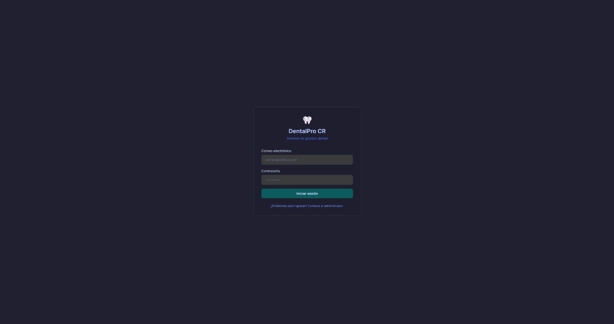
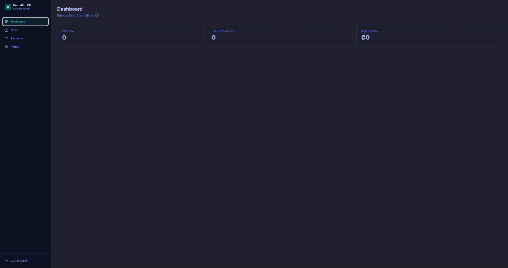
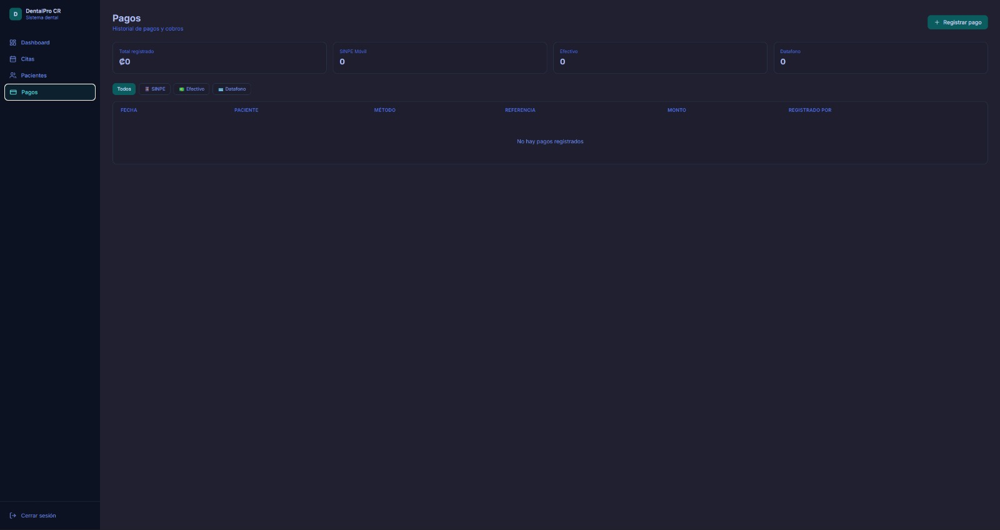

# Dental Pro CR

Web application for managing a dental clinic: patients, appointments and payment records.

> **Status: work-in-progress demo.** This is a portfolio project. The CRUD flows below work end to end; the dashboard and several modules are still pending (see the [Roadmap](#roadmap)).

**Live demo:** https://dental-pro-cr-a1i9.vercel.app/login

| Test user |                       |
| --------- | --------------------- |
| Email     | `admin@dentalpro.com` |
| Password  | `Admin12345`          |

_The test account only contains fictional data._

---

## Features

- **Authentication** with Supabase Auth. Middleware protects every route and redirects to the login page when there is no session.
- **Patients:** list with name search and creation of new patients (contact info, emergency contact, allergies and medical notes).
- **Appointments:** list and creation, linking a patient, a staff member and a service.
- **Payments:** manual payment records with amount, currency (CRC or USD) and method (SINPE Móvil, cash or card terminal); filter by method and listing total. Registering a payment for an appointment marks it as _completed_.
- **Role-based access:** only `admin` and `receptionist` can create patients and record payments.
- **Multi-clinic data isolation:** API queries are scoped to the authenticated user's clinic.

> Payments are recorded by hand. There is no integration with SINPE Móvil, card terminals or any payment gateway.

## Screenshots

| Login                           | Dashboard                               |
| ------------------------------- | --------------------------------------- |
|  |  |

| Patients                              | Appointments                                  | Payments                              |
| ------------------------------------- | --------------------------------------------- | ------------------------------------- |
|  |  |  |

---

## Tech Stack

| Layer              | Technologies                                                                   |
| ------------------ | ------------------------------------------------------------------------------ |
| Frontend           | Next.js 14 (App Router), React 18, TypeScript, Tailwind CSS, shadcn/ui (Radix) |
| Forms & validation | React Hook Form, Zod                                                           |
| Backend / DB       | Next.js API Routes, Supabase (PostgreSQL + Auth)                               |
| Deployment         | Vercel                                                                         |

---

## Getting Started

```bash
git clone https://github.com/HadjyKaleth/dental-pro-cr.git
cd dental-pro-cr
npm install
```

Create a `.env.local` file:

```env
NEXT_PUBLIC_SUPABASE_URL=your_supabase_url
NEXT_PUBLIC_SUPABASE_PUBLISHABLE_KEY=your_supabase_publishable_key
```

Run the development server:

```bash
npm run dev
```

Open http://localhost:3000

---

## Project Structure

```text
app/
  (auth)/login/        Login page
  (dashboard)/         Dashboard, patients, appointments and payments
  api/                 Endpoints: patients, appointments, payments
components/            UI (shadcn/ui) and layout
lib/
  supabase/            Supabase clients (server and browser)
  utils/api-auth.ts    withAuth, requireRole, rate limiting
middleware.ts          Route protection
```

---

## Roadmap

- [ ] Dashboard with real data: today's appointments, active patients, monthly income by payment method
- [ ] Service management (CRUD)
- [ ] Edit and cancel appointments and patients
- [ ] PDF payment receipt
- [ ] SQL schema script (`supabase/schema.sql`) to reproduce the database
- [ ] Automated tests for the API endpoints

---

## Author

**Hadjy Kaleth Núñez Rivera**
GitHub: [@HadjyKaleth](https://github.com/HadjyKaleth)
