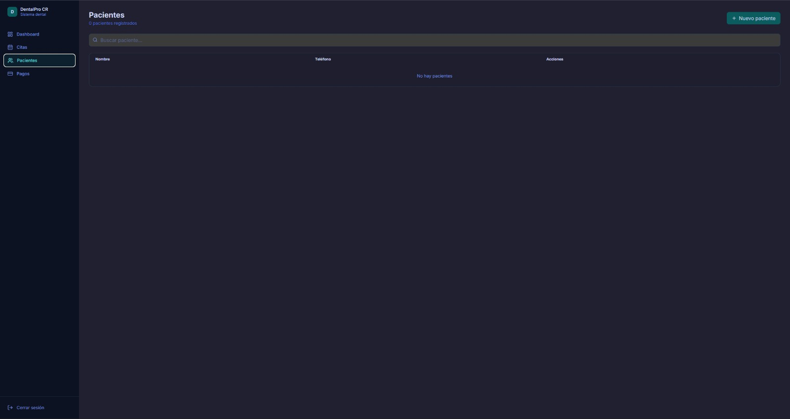
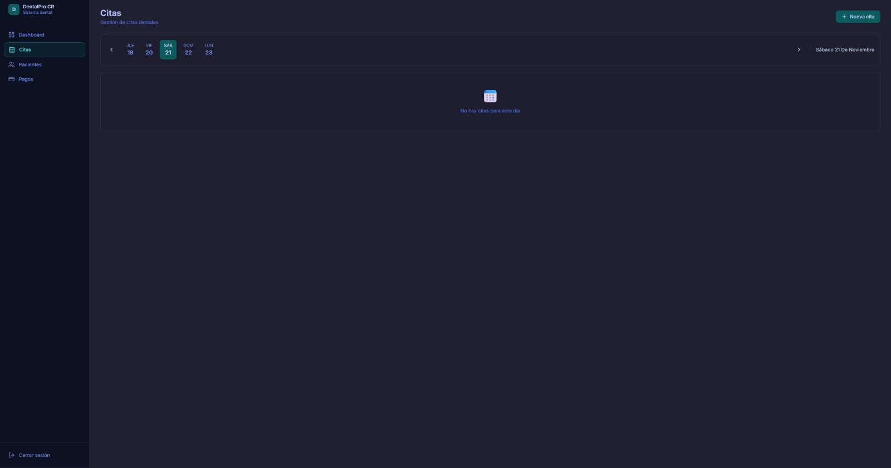

# 🦷 Dental Pro CR

A modern full-stack web application for managing dental clinics, patients, appointments, services, and payments.

This project was developed as a personal portfolio project to strengthen my full-stack development skills using modern web technologies.

---

# Live Demo

**Website:** https://TU-URL-DE-VERCEL.vercel.app

---

## Overview

Dental Pro CR is a web application designed to help dental clinics manage their daily operations from a single platform.

The application provides authentication, patient management, appointment scheduling, service administration, and payment tracking through a clean and responsive interface.

---

## Features

- Secure authentication with Supabase Auth
- Patient management
- Appointment scheduling
- Dental service management
- Payment tracking
- Clinic administration
- Responsive user interface
- Cloud database with Supabase
- Production deployment with Vercel

---

## Tech Stack

### Frontend

- Next.js
- React
- TypeScript
- Tailwind CSS

### Backend

- Supabase
- PostgreSQL
- Supabase Authentication

### Deployment

- Vercel

---

## 📁 Project Structure

```text
app/
components/
lib/
public/
middleware.ts
```

---

## ⚙️ Installation

Clone the repository:

```bash
git clone https://github.com/HadjyKaleth/dental-pro-cr.git
```

Navigate to the project:

```bash
cd dental-pro-cr
```

Install dependencies:

```bash
npm install
```

Create a `.env.local` file:

```env
NEXT_PUBLIC_SUPABASE_URL=YOUR_SUPABASE_URL
NEXT_PUBLIC_SUPABASE_PUBLISHABLE_KEY=YOUR_SUPABASE_PUBLISHABLE_KEY
```

Run the development server:

```bash
npm run dev
```

Open:

```
http://localhost:3000
```

---

## Screenshots

### Login


---

### Dashboard


---

### Patients



---

### Appointments



---

### Payments


---

## What I Learned

Through the development of this project, I strengthened my experience in:

- Building full-stack web applications using Next.js and TypeScript.
- Designing relational databases with PostgreSQL.
- Implementing authentication and session management with Supabase Auth.
- Creating CRUD operations for multiple business entities.
- Developing responsive user interfaces with Tailwind CSS.
- Managing application deployment using Vercel.
- Working with Git and GitHub for version control and collaboration.
- Integrating frontend and backend services into a complete web application.

---

## Author

**Hadjy Kaleth Núñez Rivera**

- GitHub: https://github.com/HadjyKaleth

---

## Notes

This project was developed for learning purposes and as part of my software development portfolio.
